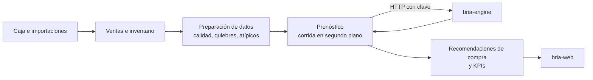

# bria. · API

Núcleo de **bria.**, el sistema de apoyo a decisiones de inventario para pequeños negocios retail del Perú. Registra la operación diaria de cada tienda (caja, ventas, inventario y compras), prepara ese historial, pide el pronóstico a [`bria-engine`](https://github.com/bria-app/bria-engine) y lo convierte en lo que el dueño necesita decidir: cuánto comprar, cuándo y por qué.



## Stack

Python 3.11 · FastAPI · SQLAlchemy 2 · Alembic · PostgreSQL 16 · Pydantic · JWT · bcrypt · httpx.

## Arquitectura

Es un **monolito modular con arquitectura hexagonal**: un solo servicio desplegable, con módulos separados por dominio y una dirección de dependencias que las pruebas verifican. El motor de pronóstico es un servicio aparte y se consume mediante un adaptador.

```text
presentation    → application → domain
infrastructure  → application y puertos de domain
domain          → no depende de ningún framework
```

```text
app/
├── bootstrap/     Registro de routers y modelos
├── modules/       Un módulo por dominio
│   └── <módulo>/
│       ├── domain/          Reglas de negocio puras
│       ├── application/     Casos de uso y puertos
│       ├── infrastructure/  Modelos ORM, repositorios y adaptadores
│       └── presentation/    Endpoints y esquemas
├── shared/        Base de datos, seguridad, almacenamiento y HTTP
├── config.py      Configuración
└── main.py        Punto de entrada y controles al arrancar
migrations/        Migraciones de Alembic
scripts/           Empresa de demostración y verificación del motor
tests/             Pruebas
docs/              Decisiones de arquitectura y guía funcional
```

| Módulo | Responsabilidad |
|---|---|
| `auth`, `companies` | Sesiones, usuarios, roles (dueño, administrador, vendedor), empresas y registro |
| `products`, `custom_fields` | Catálogo, categorías, códigos, y columnas con reglas propias de cada negocio |
| `sales`, `invoicing` | Caja, ventas, ventas perdidas, anulaciones, historial y comprobantes |
| `inventory` | Movimientos, stock y ajustes |
| `purchases`, `suppliers` | Compras y proveedores con validación de RUC |
| `ingestion`, `files` | Carga, mapeo y validación de Excel y CSV |
| `data_preparation` | Calidad de datos, quiebres y series listas para pronosticar |
| `forecasting` | Corridas en segundo plano y conexión con el motor |
| `recommendations`, `kpis` | Sugerencia de compra, cobertura, riesgo de quiebre y sobrestock |
| `dashboard`, `reports`, `notifications` | Resumen del día, reportes y avisos |
| `billing` | Planes Gratis y Premium, con pago de demostración |
| `admin`, `audit`, `validation` | Administración, auditoría y validación |

Las decisiones de arquitectura están en [`docs/decisiones.md`](docs/decisiones.md) y las entidades y flujos, en [`docs/guia-funcional.md`](docs/guia-funcional.md).

## Reglas que importan

- **Cada empresa ve solo lo suyo.** Las consultas filtran por `company_id` desde la sesión, nunca desde un dato que envía el cliente.
- **Un quiebre no es falta de demanda.** Los días sin stock se marcan antes de pronosticar, y las ventas perdidas en caja cuentan.
- **Los permisos los aplica el servidor,** por rol y por plan.
- **Sin motor no se inventa un resultado.** La corrida falla con un mensaje claro. El modo de demostración está bloqueado en producción.

## Arranque

Para levantar el sistema completo con datos de prueba, usa [`bria-local`](https://github.com/bria-app/bria-local). Para trabajar solo en la API, con Python 3.11 o superior y PostgreSQL en marcha:

```bash
python -m venv .venv
```

Activa el entorno con `.venv\Scripts\activate` en Windows o `. .venv/bin/activate` en Linux y macOS, y copia `.env.example` como `.env`. Luego:

```bash
pip install -e ".[dev]"
```

```bash
alembic upgrade head
```

```bash
uvicorn app.main:app --port 8000 --reload
```

La documentación interactiva queda en http://localhost:8000/docs. `.env.example` lista todas las variables; estas son las principales:

| Variable | Para qué |
|---|---|
| `DATABASE_URL` | Conexión a PostgreSQL |
| `APP_ENV` | Entorno. En producción, `production` |
| `JWT_SECRET_KEY` | Firma de sesiones. En producción, 32 bytes o más: si no, la API no arranca |
| `CORS_ORIGINS`, `CORS_ORIGIN_REGEX` | Sitios que pueden llamar a la API |
| `FTGM_ENGINE_BASE_URL`, `FTGM_ENGINE_API_KEY` | Dirección y clave del motor |
| `FTGM_ENGINE_MODE` | `real` o `mock`. Con `mock` también debe activarse `ALLOW_FTGM_MOCK`, y en producción no arranca |
| `FTGM_ENGINE_TIMEOUT_SECONDS` | Tiempo máximo de espera del motor |
| `STORAGE_BACKEND` | Dónde se guardan los archivos: `db` o disco |
| `SEED_DEMO`, `DEMO_OWNER_PASSWORD`, `DEMO_SELLER_PASSWORD` | Carga de la empresa de demostración |

### Empresa de demostración

Con `SEED_DEMO=true` y las dos contraseñas definidas, `scripts/bootstrap_demo.py` carga PetHouse Lima una sola vez: datos sintéticos con 12 productos y ventas desde 2022 hasta ayer. La imagen Docker lo ejecuta al arrancar, después de las migraciones. El código no trae contraseñas por defecto.

## Pruebas

```bash
DATABASE_URL=sqlite:// pytest tests -q
```

En PowerShell, define antes `$env:DATABASE_URL = "sqlite://"`. Las pruebas cubren los casos de uso, la pureza del dominio, el aislamiento entre empresas, los permisos por rol, la importación, los planes y los flujos de caja, compras y pronóstico.

## Despliegue

Va en Railway con `Dockerfile` y `railway.json`: al arrancar aplica las migraciones y publica en `$PORT`. La guía completa está en [`bria-local/docs/DESPLIEGUE.md`](https://github.com/bria-app/bria-local/blob/main/docs/DESPLIEGUE.md).

## Límites conocidos

- Algunas rutas secundarias siguen como andamiaje: responden un mensaje fijo, no leen ni guardan datos, y varias no piden sesión. La web no depende de ellas. Las reconoces porque devuelven `Endpoint scaffold ready`.
- La recuperación de contraseña por correo todavía no está disponible.
- El pago de Premium es de demostración y los comprobantes no se envían a SUNAT.

Proyecto de tesis de Ingeniería de Software, UPC (TP2026010042). Uso académico: el código no se distribuye con licencia abierta.
